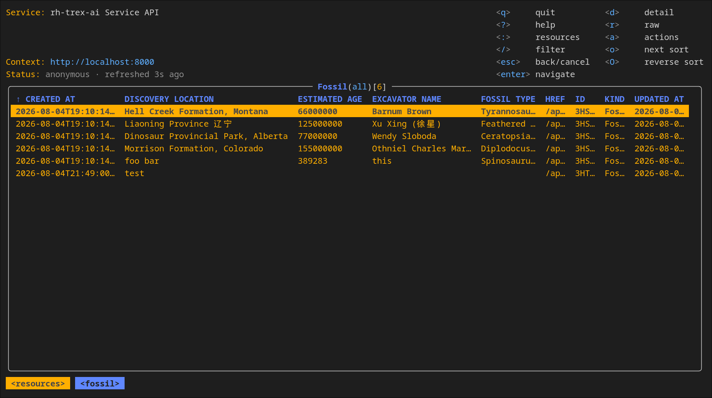

# TRex

**T**rusted **R**EST **Ex**ample


A production-ready REST and gRPC API template for bootstrapping new Go microservices. Ships with "dinosaurs" as placeholder business logic — replace them with your own.

## Features

- REST + gRPC dual-protocol API with OpenAPI spec generation
- Plugin-based entity architecture with auto-registration
- Entity code generator (`trex generate-entity` / `new-entity`) scaffolded into new apps
- `trexctl` component (generated CLI + Bubble Tea TUI in one binary) built with `make ctl`
- CLI/TUI generators (`scripts/cli-generator/`, `scripts/tui-generator/`) produce it from your OpenAPI spec
- PostgreSQL with GORM, migrations, and advisory locks
- Event-driven controllers via PostgreSQL LISTEN/NOTIFY
- JWT authentication with multi-issuer support (multiple JWK URLs + file)
- Server-streaming gRPC (watch for real-time events)
- Prometheus metrics, health checks, structured logging
- Spec-Driven Development with agent-executable skills



## Quick Start

```sh
# Prerequisites: Go 1.24+, Docker, buf (for protobuf)
# See PREREQUISITES.md for details

# Build
make proto
make binary

# Database
make db/setup
./trex migrate

# Run (no auth, for local dev)
make run-no-auth

# In another terminal, browse and operate on API resources
./generated/ctl/trexctl tui --server http://localhost:8000
```

REST API: `http://localhost:8000` | gRPC: `localhost:9000` | Metrics: `localhost:8080` | Health: `localhost:8083`

## Start a New Application (Bootstrap)

Scaffold a brand-new TRex-based microservice in a separate repository with one command:

```sh
curl -sSL <url>/scripts/bootstrap.sh | bash -s -- <project-name> [repo-base] [dir]
```

Examples:

```sh
# Create ./my-service with module base github.com/myorg
curl -sSL <url>/scripts/bootstrap.sh | bash -s -- my-service github.com/myorg

# Create in a specific parent directory
curl -sSL <url>/scripts/bootstrap.sh | bash -s -- my-service github.com/myorg ~/code
```

What it does:

1. Resolves the TRex source: uses `TREX_SRC` if set, else clones `TREX_REPO_URL` (cached in `$HOME/.trex/src`) — or skips both when `TREX_PUBLISHED=1`.
2. Writes a minimal Go harness (a `go.mod` plus a small `main.go` that imports `pkg/cmd`), so the commands are inherited from the library — no separate CLI build.
3. Runs the inherited `new-project` command, which scaffolds the project structure and substitutes all placeholders.
4. Points the new project's `replace` directive at the TRex source used, so it builds immediately (removes it when published).
5. Optionally runs `make generate && go mod tidy && make binary` to verify the scaffold builds.

The scaffolded project is a complete Go service that imports the TRex library and inherits all server commands (`serve`, `migrate`, `new-entity`, `new-project`). Its client component (`<name>ctl`, generated CLI + TUI) is built with `make ctl`. It also ships a `specs/entities.yaml` manifest and `make verify-entities` / `make generate-entities` targets, so generated code can be checked for conformance against the TRex templates — especially after upgrading the library (see the project README).

Then add your first entity:

```sh
cd my-service
./my-service new-entity --kind HelloWorld --fields "message:string:required" \
  --project my-service --repo github.com/myorg \
  --library github.com/openshift-online/rh-trex-ai/components/api-server \
  --module github.com/myorg/my-service --proto-package my_service
make proto && make generate && go build ./...
```

Environment variables (all optional):

| Variable | Default | Purpose |
| --- | --- | --- |
| `TREX_REPO_URL` | `https://github.com/openshift-online/rh-trex-ai` | Git URL for the TRex source |
| `TREX_BRANCH` | remote default branch | Branch/tag to fetch |
| `TREX_SRC` | — | Use an existing local checkout (skips cloning) |
| `TREX_HOME` | `$HOME/.trex` | Cache dir for the clone |
| `TREX_PUBLISHED` | `0` | Set to `1` when the library is published (skips clone/replace) |
| `SKIP_BUILD` | `0` | Set to `1` to skip the verification build |

## Usage

```sh
# REST
curl http://localhost:8000/api/rh-trex/v1/dinosaurs | jq
curl -X POST http://localhost:8000/api/rh-trex/v1/dinosaurs \
  -H "Content-Type: application/json" -d '{"species": "Velociraptor"}' | jq

# gRPC
grpcurl -plaintext localhost:9000 rh_trex.v1.DinosaurService/ListDinosaurs
grpcurl -plaintext localhost:9000 rh_trex.v1.DinosaurService/WatchDinosaurs

# Terminal UI (use --token-file when the server requires authentication)
./generated/ctl/trexctl tui --server http://localhost:8000
```

## Generate a New Entity

```sh
# Basic
go run ./cmd/trex generate-entity --kind Rocket

# With typed fields (nullable by default, :required for non-nullable)
go run ./cmd/trex generate-entity --kind Rocket \
  --fields "name:string:required,fuel_type:string,max_speed:int,active:bool"
```

Generates the full stack: model, DAO, service, handlers, migration, OpenAPI spec, tests, and plugin registration. No manual wiring.

Supported types: `string`, `int`, `int64`, `bool`, `float`, `time`

After generation:

```sh
make binary
make db/teardown && make db/setup
./trex migrate
make run-no-auth
```

## Generate the Client Component (`trexctl`)

Build the CLI + TUI component (one binary) from the OpenAPI spec:

```sh
make ctl
./generated/ctl/trexctl --help
```

Use the generated `trexctl`:

```sh
# Login
trexctl login --token-file /dev/stdin --url http://localhost:8000 <<< "$OIDC_TOKEN"

# CRUD
trexctl list dinosaurs
trexctl create dinosaur --species Velociraptor
trexctl get dinosaur <id>

# Terminal UI
trexctl tui --server http://localhost:8000
```

## Run With Authentication

```sh
make run

# Using the generated trexctl
make ctl
trexctl login --token-file /dev/stdin --url http://localhost:8000 <<< "$OIDC_TOKEN"
trexctl list dinosaurs

# Or with curl
curl -H "Authorization: Bearer $OIDC_TOKEN" http://localhost:8000/api/rh-trex/v1/dinosaurs
```

Supports any OIDC provider. Default: Red Hat SSO. Configure signing keys via `--jwk-cert-url`. Resource servers should also set `--jwt-issuer` and `--jwt-audience` to reject signed tokens intended for another issuer or API.

## Testing

```sh
make test              # Unit tests
make test-integration  # Integration tests (requires running PostgreSQL)
make verify            # Vet + formatting checks
make lint              # golangci-lint
```

## Architecture

```
cmd/trex/              Server entrypoint (serve, migrate, generate-entity, new-project)
generated/ctl/         Generated trexctl component (CLI + TUI)
pkg/api/               Models and OpenAPI client
pkg/handlers/          REST handlers
pkg/services/          Business logic + event handlers
pkg/dao/               Data access layer (GORM)
pkg/db/migrations/     Schema migrations
pkg/auth/              JWT authentication
pkg/server/            gRPC server, routing, event broker
pkg/tui/               Shared descriptor-driven Bubble Tea runtime
plugins/               Self-registering entity plugins
proto/                 Protobuf definitions
cmd/trex generate-entity   Entity code generator (in-app command)
scripts/bootstrap.sh         One-command bootstrap for new apps (curl | bash)
scripts/cli-generator/ CLI generator (emits the ctl component)
scripts/tui-generator/ TUI descriptor generator
specs/                 Formal requirements (SDD)
skills/                Agent-executable procedures
```

## Deploy to OpenShift

```sh
make crc/login
make image
make push
make deploy
```

## Further Reading

- [PREREQUISITES.md](./PREREQUISITES.md) — Development environment setup
- [GRPC.md](./GRPC.md) — gRPC API details
- [CLAUDE.md](./CLAUDE.md) — Agent/developer reference (code generation, CLI flags, architecture details)
